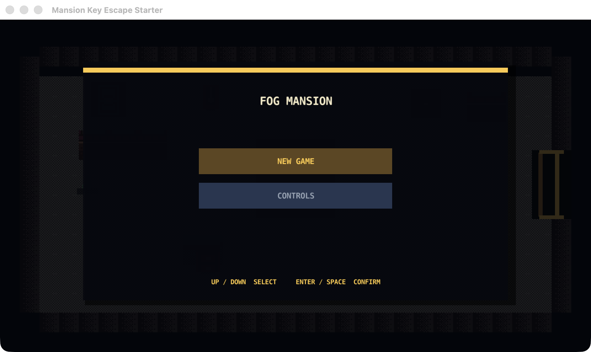
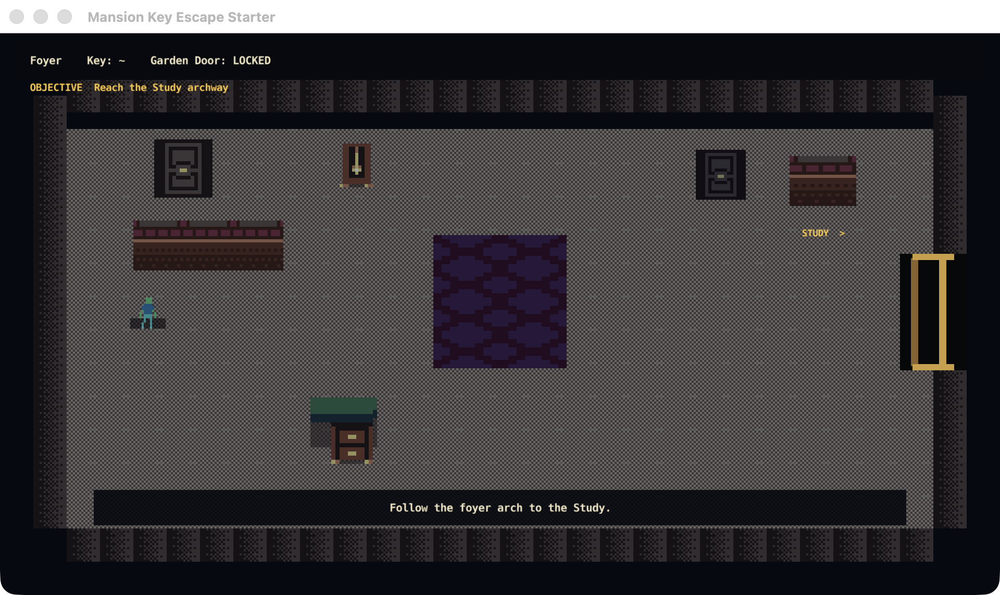
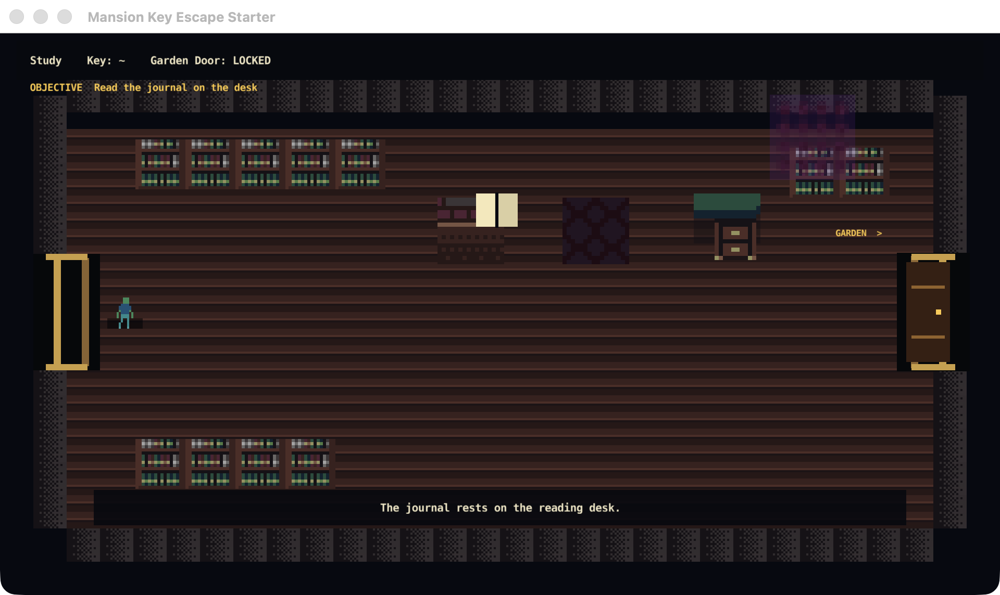
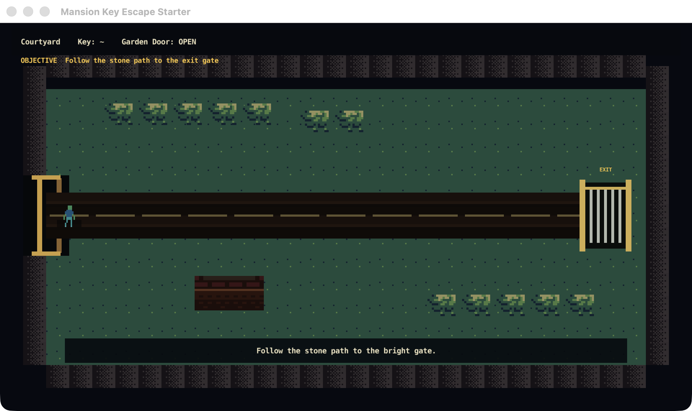

# Mist Mansion: Key Escape

GDD revision: `v2.0-editorial-20260826`  
Benchmark ID: `defold.mansion_key_escape.v2`

> This revision preserves the numbered requirements and formal semantics in Section 6. The
> supplied reference images and public logical coordinates define the target page composition and
> layout contract without exposing Gold source, private evaluation journeys, or a unique code
> structure.

## 1. One-sentence task

Build a top-down pixel-art puzzle escape game. Starting in a misty mansion foyer, the player uses
recognizable exits and room transitions to enter the study, reads a journal, investigates a hidden
cabinet, takes the revealed key, opens the locked garden door, avoids the shadow, and reaches the
exit. Contact with the shadow causes a restartable failure. See `Scenario-01`, `Scenario-02`, `Clue-01`,
`Puzzle-01`, `Puzzle-02`, `Key-01`, `Door-Lock-03`, `Exit-01`, `Threat-01`, `Threat-02`, `Restart-01`,
`Visual-01`, and `Visual-04`.

## 2. Scope

### 2.1 Required in this task

| Requirements | Summary |
|---|---|
| Menu-01, Menu-02, Menu-03 | Operable main menu, Controls page, and clean New Game entry |
| Move-01, Move-02, Collision-01 | Continuous four-direction movement, hold/release behavior, and real wall/furniture collision |
| Scenario-01, Scenario-02, Layout-01, Layout-02, Layout-03 | Foyer, study, and garden as repeatably navigable independent views using the published images and logical coordinates |
| Interaction-01, Interaction-02 | Discoverable environmental interactions and safe empty, out-of-order, and repeated interactions |
| Clue-01, Puzzle-01, Puzzle-02, Key-01 | A journal, hidden cabinet, and unique key forming an ordered two-step investigation |
| Door-Lock-01, Door-Lock-02, Door-Lock-03, Door-Lock-04 | No-key rejection, a closed boundary that cannot be bypassed, key consumption, and synchronized visual/physical opening |
| Exit-01 | Reach the garden exit after the complete flow and enter success |
| Threat-01, Threat-02 | An avoidable shadow on the normal route and a Game Over state |
| Restart-01, Lifecycle-01 | Failure restart, repeated New Game, and close/reopen all return to no progress |
| Visual-01, Visual-02, Visual-03, Visual-04, Reference-Screen-01 | Recognizable pixel world, complete separate rooms, rendering/gameplay alignment, and the main reference compositions |
| Interface-01, Interface-02, Reference-Screen-02 | Fully readable 960×540 menu, HUD, modal, success, and failure information hierarchy |

### 2.2 Out of scope

| Related requirements | Excluded content |
|---|---|
| None | The original full map, multiple floors, multiple keys, multiple code boxes, gem tablets, complex inventory, networking, and a full story |
| Threat-01 | A fixed enemy algorithm, patrol coordinates, speed, damage value, or random behavior |
| Scenario-01, Scenario-02, Visual-01～04, Interface-01～02, Reference-Screen-01～02 | A required scene-file count, transition technique, font, animation count, audio, or pixel-identical screenshots. Ordinary decoration and code organization remain free outside the published anchors, corridors, and UI regions |

## 3. Starting point

| Item | Starting state | Related requirements |
|---|---|---|
| Project | `starter_project/` is a minimal launchable Defold project with public keyboard actions | Quality-01, Move-01 |
| Assets | `assets/` contains mansion tiles and shadow art; `reference/` contains target page images exported from frozen Gold | Visual-01, Reference-Screen-01, Reference-Screen-02 |
| Target gameplay | No menu, player, level, puzzle, lock, threat, or outcome flow exists yet | All Section 6.2 requirements |
| Progress | No key, open door, or completion state exists | Menu-03, Restart-01, Lifecycle-01 |
| Player input | W/A/S/D or arrows move with continuous hold/release; Enter or Space confirms/interacts; Escape goes back | Menu-01, Menu-02, Move-01, Move-02, Interaction-01 |

## 4. Player goal and complete flow

### 4.1 Goal

Escape the mansion using the published page references and logical coordinates: navigate the
foyer, study, and garden through room exits and transitions; complete the ordered two-step
investigation; take the key; open the garden door; and reach the exit while using danger feedback
to avoid the shadow. See `Scenario-01`, `Scenario-02`, `Layout-01`, `Layout-02`, `Layout-03`, `Clue-01`,
`Puzzle-01`, `Puzzle-02`, `Key-01`, `Door-Lock-03`, `Threat-01`, `Exit-01`, and `Reference-Screen-01`.

### 4.2 Complete flow

```text
Enter the game
→ [Menu-01, Menu-03] Choose New Game and enter a clean run
→ [Move-01, Move-02, Collision-01, Scenario-01, Scenario-02, Layout-01, Layout-03]
  Explore the foyer and study through fixed exits and guaranteed corridors
→ [Interaction-01, Clue-01] Find, open, and read the journal
→ [Puzzle-01, Puzzle-02] Use the journal clue to investigate the study cabinet and reveal the key
→ [Key-01] Take the unique key
→ [Door-Lock-03, Door-Lock-04] Unlock the garden door and cross its physically open passage
→ [Exit-01] Reach the garden exit and win
```

The normal route is affected by the shadow in `Threat-01`. Contact triggers `Threat-02`, after which
`Restart-01` starts a clean run.

### 4.3 Core loop

```text
[Move-01, Move-02, Collision-01, Layout-03] Hold a direction to move, release to stop, and read fixed routes
→ [Interaction-01] Discover and inspect nearby targets
→ [Clue-01, Puzzle-01, Puzzle-02, Key-01, Door-Lock-03] Gain information or change a route
→ [Threat-01] Wait, detour, or continue using danger feedback
→ Choose the next objective
```

## 5. Player controls

| Requirements | Action | Context | Response summary |
|---|---|---|---|
| Menu-01, Menu-02, Menu-03 | Up/down, confirm, back | Main menu and Controls | Change selection, enter instructions, return, or start |
| Move-01, Move-02, Collision-01 | W/A/S/D or arrows | Playing | Move continuously while held, stop after release, collide with world boundaries, walls, and furniture |
| Interaction-01, Interaction-02 | Enter or Space | Near a target or in empty space | Inspect, open a clue, advance a puzzle, pick up, or receive non-progress feedback |
| Clue-01 | Confirm or back | Journal modal | Close the journal and resume |
| Door-Lock-01, Door-Lock-03 | Enter or Space | Near the garden door | Reject without a key; unlock and consume the key when held |
| Restart-01 | Confirm | Game Over | Return to a clean New Game state |

### 5.1 Reference pages and public coordinates

The target logical canvas is `960×540` with a bottom-left origin. These images are exported from
frozen Gold using the same logical canvas and are part of the public Input. They are Retina window
captures, so the files may be twice the logical dimensions and include a title bar. Section 6's
logical coordinates, regions, and tolerances govern dynamic navigation; the images govern major
composition and information hierarchy without requiring pixel-identical reproduction.

Main menu (`Reference-Screen-02`, `Menu-01`):



Foyer (`Reference-Screen-01`, `Layout-01`, `Layout-02`):



Study and closed garden door (`Reference-Screen-01`, `Layout-01～03`, `Door-Lock-04`):



Garden (`Reference-Screen-01`, `Layout-01`, `Layout-02`, `Exit-01`):



See `reference/05_journal.png`, `06_key_found.png`, `07_door_open.png`, `09_victory.png`,
`10_game_over.png`, and `11_restarted.png` for the journal, revealed key, open door, success,
failure, and restarted foyer. Controls is `02_controls.png`. These pages are governed by
`Reference-Screen-01` or `Reference-Screen-02`.

## 6. Numbered requirements: the sole acceptance basis

This section is the only formal definition of the task. Every other section summarizes and cites
these identifiers.

### 6.1 Granularity

Each identifier describes a player result that can fail and be repaired independently. Tightly
coupled effects of one action may remain together, such as taking a key removing its world item and
showing the held-key state; internal variables and individual prompt lines are not separate goals.

### 6.2 Game-specific requirements

| Requirement | Preconditions | Player action or trigger | Required result | Forbidden result | Visible feedback | Failure, repetition, restart, or other boundary |
|---|---|---|---|---|---|---|
| Menu-01 | Project launch or return from success | Repeatedly press Up and Down | Main menu shows New Game and Controls, and the current selection truly changes on every Up/Down input | Do not auto-start; do not use an unchanging static arrow as fake selection; menu arrows cannot move the game character | Selected and unselected items have clearly different highlight, arrow, color, or equivalent treatment | Selection remains correct after repeated toggles and remains operable after close/reopen |
| Menu-02 | Controls selected on the main menu | Confirm entry, then use the displayed back operation | Show movement, interaction, and back instructions; returning restores the operable main menu | Controls cannot start the game or trap the player | Controls title, key instructions, and back method are fully readable | Enter and leave twice without duplicated or stale UI |
| Menu-03 | New Game selected, including after a previous run | Confirm New Game | Enter a controllable new game in the foyer with unread clue, unresolved cabinet, unrevealed/unheld key, locked garden door, and all result/reading UI closed | No previous key, open door, danger, success, or failure may persist | Normal game view and initial task hint are visible, and movement works | Two consecutive New Games produce the same kind of clean state |
| Move-01 | Playing with no journal or result modal | Hold and release any of four directions | Move continuously in that direction in the top-down scene and stop that direction after release | One direction input cannot directly pick up, unlock, or win; no drift after release | Position change is clear; facing or walking animation may strengthen feedback | Direction changes remain controllable; simultaneous keys may use any stable reasonable policy |
| Move-02 | Playing in an unobstructed corridor from `Layout-03` | Hold one direction for at least 600ms, observe at least twice while held, then release and observe at least 300ms | Continue moving in the same direction throughout the hold instead of stepping only on press; stop that movement within 300ms after release | Do not depend on OS key repeat and do not drift after release | Position visibly changes throughout the hold and stabilizes after release | W/A/S/D, arrows, and the public equivalent action adapter share press/hold/release semantics; collision may stop movement first under `Collision-01` |
| Collision-01 | Playing while facing a boundary, wall, or furniture | Keep moving into it, then turn away | The obstacle prevents penetration, and the player can turn and continue afterward | Do not become stuck inside, pass through obvious solids, or trigger an outcome from collision | Stop position substantially agrees with the visible obstacle | Two repeated collide-and-leave attempts remain stable |
| Scenario-01 | A new game has started | Leave the current room through its designated exit and continue exploring | Foyer, study, and garden each have an independent playable room view occupying the main viewport; a clear exit connects foyer/study, while a lock-controlled exit connects study/garden; crossing a valid `Layout-01` exit transitions to the target room | Do not keep all three complete rooms compressed into one overview as the entire exploration; do not enter garden/exit while locked; do not merely change an area label while showing the same room | Before/after rooms differ in floor, walls, furniture, exits, and main palette in a way corresponding to references, so the space change is visually clear | Multiple collections or a fixed transition technique are not required; direct cuts, fades, camera movement, or equivalents are allowed |
| Scenario-02 | Entering another room through a valid exit | Perform foyer→study→foyer, then enter garden after unlocking | Each transition fires once; spawn at the safe matching entrance in the target room; keep puzzle/key/lock/outcome progress; a released direction does not keep moving after transition | No transition bouncing, wall/furniture spawn, spawn on key/shadow/exit, stale collision/interactions from the old room, or lost progress | Show only the current room and its HUD, prompts, and valid objects; area feedback matches the image and leaves no old graphics/prompts/masks | Foyer/study remains stable over two round trips; restart/New Game begins in foyer |
| Layout-01 | `960×540` logical canvas with bottom-left origin | Start and traverse room exits | Main playable bounds are `x=64～896, y=64～464`; foyer→study uses right opening `x≥850, y=240～304`; study→foyer uses left opening `x≤110, y=240～304`; study→garden uses the lock-controlled right opening at the same height. Spawn near `(142,272)` in foyer, `(120,272)` at study entry, and `(96,272)` at garden entry, each within ±24px | Valid exits cannot be elsewhere, and entrance spawn cannot immediately contact a solid, key, shadow, or exit | Openings appear in the matching left/right walls, and transitions place the player at the opposite safe entrance | Decoration may extend outside playable bounds but cannot cover openings or change passage semantics |
| Layout-02 | Player is in the corresponding room | Find and approach targets using the references | Anchors: foyer painting `(176,410)`, clock `(344,410)`; study journal `(476,370)`, key reveal `(590,274)`, cabinet `(698,354)`, locked garden door `(856,272)`; garden exit `(840,272)`. Centers allow ±24px, and interaction range reaches at least a player 60px from the anchor; journal/cabinet may use a larger reasonable range | Do not place a named target in another room, unreachable space, or more than 24px from its anchor; ordinary decoration cannot impersonate it | Art is recognizable relative to its reference and entering range shows interaction feedback | The key may remain hidden before the puzzle but appears near its anchor afterward; the exit succeeds only after the flow is complete |
| Layout-03 | Player explores the fixed layout using normal movement | Move continuously along the specified corridors | Keep the foyer horizontal corridor from spawn to the right study opening at `y=240～304` passable; keep the study corridor from left entry to the locked door at `y=240～304` passable except for the door; keep a lower safe bypass at `y=160～230` that can reach door interaction range; keep the garden corridor from entry to exit at `y=240～304` passable | Furniture, decoration, or invisible collision cannot permanently block these guaranteed routes; the locked door must still close garden access under `Door-Lock-02` | Floor, carpet, open space, doorway, or equivalent cues show the main travel direction | Shadow may temporarily cross the study route only while satisfying the observable/waitable/avoidable conditions in `Threat-01` |
| Interaction-01 | Player approaches an environment target | Observe proximity feedback and press interact | At least three environment target classes exist in foyer/study; proximity reveals interactivity, and interaction gives a target-appropriate response | Do not require blind interaction across a map with no spatial cue | Question mark, icon, outline, text hint, or equivalent proximity cue is visible; response may use panel, text, animation, or sound | Cue disappears out of range; the target can be approached and used again |
| Interaction-02 | Playing; the player interacts with empty space, an ordinary target, or a target lacking prerequisites | Perform an empty, out-of-order, or repeated ordinary interaction | Give non-destructive feedback, preserve main progression, and permit the correct sequence afterward | It cannot grant the key, unlock the door, enter garden, win, or duplicate a reward | The player can tell nothing advanced or receives an explanation matching current prerequisites | Repeating the same invalid action twice remains stable |
| Clue-01 | Near the journal in the study | Open it, then confirm/back to close | Show a readable journal modal clearly separate from the persistent HUD; its content points to the study cabinet; ordinary movement pauses while reading and resumes after close | The journal itself cannot reveal/grant the key, unlock the door, or win | Journal title, body, and close method are fully visible | It can be reopened; rereading does not advance twice |
| Puzzle-01 | Journal has not been read | Find and inspect the cabinet | Cabinet remains unresolved, key remains hidden, and feedback explains that a clue is missing | Do not skip the journal and resolve the cabinet or obtain the key | Feedback implies a secret or missing clue without fixed wording | Repeated early checks preserve progress; reading later still works |
| Puzzle-02 | Journal read and cabinet unresolved | Inspect the cabinet again | Resolve the cabinet and reveal or enable the key without automatically taking it | It cannot remain completely unchanged or directly put the key into inventory | The player understands that the compartment opened and a key can now be taken | Rechecking cannot create a second key |
| Key-01 | Cabinet resolved; key revealed and not taken | Approach and interact with the key | Take the unique key, remove the pickup from the scene, and show the held-key state in HUD/icon/equivalent UI | The same key cannot be taken twice or become pickable before the puzzle | Key art, pickup feedback, and held state are clear | Restart/New Game restores unrevealed and unheld state |
| Door-Lock-01 | Garden door locked; player has no key | Approach and interact | Door stays closed/locked, player remains outside, and receives a need-key rejection | Do not unlock, consume a nonexistent key, or place the player in garden | Closed state, proximity cue, and rejection are perceivable | Repeated no-key interaction changes nothing; unlocking works after the key is acquired |
| Door-Lock-02 | Garden door closed and locked | Try entering through center, both sides, and adjacent boundary | Closed door plus adjacent boundary block garden access | No bypass through sides, wall edge, seam, or another unexplained gap | Visible closed boundary agrees with where movement stops | Collision implementation is free, but all reasonable adjacent attempts agree while locked |
| Door-Lock-03 | Player holds the unique key and door is locked | Interact near the door, then cross | Unlock the door, consume the key, make the opening traversable, and allow garden entry | Do not retain held key, leave an invisible blocker, or require another key | Unlock feedback, disappearance of held-key state, and a clear passable opening are visible | The open door can be crossed repeatedly during the run without consuming another key |
| Door-Lock-04 | Player can observe locked and unlocked states | Observe and cross before/after unlocking | Locked door panel and adjacent wall form one visibly closed boundary; after unlock, the panel disappears, opens, or clearly changes and leaves an opening matching real traversal | No "solid image but passable" or "visible opening but invisible wall" contradiction | The view alone distinguishes locked, open, and traversable area | Restart restores both visible panel and physical lock |
| Exit-01 | Door unlocked normally and player has entered garden | Move to the clearly recognizable garden exit | Enter clear success; ordinary movement and environment interaction stop advancing the run; player can return to menu or start a new game | Cannot succeed before taking the key, unlocking, and entering garden | Exit art and result UI clearly communicate escape and next actions | Returning/menu/New Game clears result and requires the full flow again |
| Threat-01 | Playing and shadow has not touched player | Explore a route needed for key, locked door, or exit | Shadow activity/danger overlaps at least one necessary route; the player sees it and can avoid contact by moving, waiting, or detouring; proximity creates danger feedback | Do not place it in an irrelevant ignorable corner or create unavoidable immediate failure after New Game | Shadow or its main effect is recognizable, and danger feedback noticeably changes with proximity | No fixed patrol is required; equal initial conditions give reasonable reaction time |
| Threat-02 | Playing | Actually touch the shadow or remain inside a clearly signaled contact-danger area | Enter Game Over; ordinary movement and interaction no longer advance the main flow | Mere proximity without contact cannot fail; Game Over cannot also count as success | Clear failure UI and restart operation are visible | Failure can invoke `Restart-01` |
| Restart-01 | Game Over | Use the failure UI restart | Return to initial foyer position with unread journal, unresolved cabinet, unrevealed/unheld key, closed locked garden door, cleared danger/outcomes, and all temporary panels closed | No puzzle, key, open-door, danger, win, or failure UI may persist | Show the same controllable start state as first New Game | Two repeated fail/restart cycles recover correctly |
| Lifecycle-01 | A run has changed puzzle, key, door, danger, or outcome state | Return to menu and repeatedly choose New Game; also truly close and relaunch | Every New Game is clean; a new process starts at a no-progress menu or equivalent initial entry | No task progress, held movement key, temporary panel, or duplicated UI persists across New Game or process | Menu and clean run match first launch | Saving task progress is not required |
| Visual-01 | Normal game view | Explore the main flow | Player, floor, walls, major furniture, journal, key, locked door, exit, and shadow use purpose-appropriate pixel graphics; supplied mansion tiles are used in the main world and supplied shadow art in the real threat or its main effect | Solid-color blocks cannot carry most world presentation; persistent labels such as `YOU`, `KEY`, `SHADOW`, or `LOCKED` cannot be the main way to explain objects; do not show a whole asset sheet merely as a preview | The exploration view is one coherent pixel-game world whose key objects remain recognizable without persistent name labels | Combining, cropping, tinting, tiling, and self-made pixel art are allowed; optional audio is not required |
| Visual-02 | Explore all three areas at the public default resolution | Observe rooms and main routes | Walkable areas have continuous floor/background coverage; every area has walls, exits, and multiple purpose-appropriate furnishings; material, structure, or furnishings make rooms distinct | No default transparent/black gaps, uncovered strips, or large obviously unfinished areas; names alone cannot distinguish rooms | The player can read boundaries, main routes, and exploration direction | Gameplay space/negative space is allowed; no fixed object count or exact decoration layout |
| Visual-03 | Move, collide, and approach key objects | Observe character, walls, furniture, door, key, exit, and shadow | Critical graphics keep coordinated readable pixel scale, without obvious nonuniform stretch, abnormal enlargement, blur, or floating misalignment; visible footprint substantially matches collision/interaction/danger | No severe mismatch where a distant invisible boundary blocks or the player must visibly enter a solid before collision | Appearance gives a reasonable size, location, and approach direction | Key/effects may be enlarged for readability while similar objects remain coordinated |
| Visual-04 | Enter foyer, study, and garden | Observe and explore | Each room has a complete, purpose-specific, distinguishable composition: foyer shows the mansion entry and direction to study; study centers space around left shelves, central reading/investigation, and right garden door; garden uses a left-entry-to-right-exit path | No room may be only regular blocks plus explanatory text; do not reuse the exact same layout with only a changed name; decoration cannot cover required routes, cues, or HUD | Without area labels, the player distinguishes the rooms, their purpose, and where to continue | Decoration, lighting, and detail are free but cannot change `Layout-01～03` anchors/corridors/left-right direction; no pixel-identical copy is required |
| Interface-01 | Run menu, Controls, game, journal, success, and failure at 960×540 | Complete and repeat the main UI transitions | Titles, body, selection, HUD, interaction hint, and control hint remain inside the canvas, readable, and non-overlapping; closing UI leaves no duplicated text or mask | Critical text cannot clip at window edges, be unintentionally covered, or severely overlap other critical information | The player understands current state/actions without logs | Repeated Journal or Controls opening keeps layout stable |
| Interface-02 | Main menu, Controls, journal, success, and failure shown separately | Change selection, read, and enter outcomes | Panel, whitespace, alignment, size, color, or equivalent treatment distinguishes title, body, current selection, and controls; modal UI separates sufficiently from the game background | Do not stack all information as ungrouped text; selection cannot look identical; background cannot prevent reading | Page type/current state is recognized first, then the next action | Fonts/panels may vary, but information regions satisfy `Reference-Screen-02` |
| Reference-Screen-01 | Corresponding state is foyer, locked study, journal open, key revealed, door open, garden, success, failure, or restarted foyer | Observe at the `960×540` logical canvas | The page contains the corresponding reference's major spatial relationships and key objects: room fills main viewport; HUD in top safe region; feedback at bottom; study lies right of foyer; garden door right of study; exit right of garden; modal, door, key, shadow, and result states appear on matching pages | Do not reverse the main route, omit key objects, replace the world with large flat color/labels, cover gameplay with HUD/feedback, or change only text without changing world state | The runtime page corresponds to the named reference and communicates current room, target, and key state | Reasonable crop/composition/tint and small position variation are allowed; dynamic positions follow layout/gameplay, not pixel equality |
| Reference-Screen-02 | Main menu, Controls, journal, success, or failure shown | Observe and operate | Main menu uses a centered main panel, upper title, vertically stacked New Game and Controls choices in the middle, and controls hint below; the other pages use a center panel clearly separated from the background with title/body/controls in upper/middle/lower regions. Critical content stays at least 24px from logical canvas edges | Do not turn main-menu choices into a horizontal/scattered layout that does not map to Up/Down; do not overlap title/body/controls/edges; do not show stale panels from another state | Selection is clearly highlighted; page type, body, and next action follow the reference hierarchy | Color, font, and border may vary; ±24px visual position variation is allowed while vertical order and hierarchy remain |

### 6.3 Shared numbered requirements

| Requirement | Formal requirement |
|---|---|
| Quality-01 | The project starts, runs, exits, and starts again through the published normal procedure. |
| Quality-02 | The main flow uses normal player input and does not depend on answer buttons, cheat entries, or direct result shortcuts. |
| Quality-03 | Critical entries, text, and controls are visible, discoverable, readable, and operable. |
| Quality-04 | Player actions have perceivable feedback synchronized with the real game state. |
| Quality-05 | No severe error blocks the main flow. |
| Quality-06 | Repeated runs from the same initial conditions are substantially stable. |

## 7. Success, failure, and stages

| Stage or outcome | Requirements | Summary | Must not appear early |
|---|---|---|---|
| Entry | Menu-01, Menu-02, Menu-03, Move-01, Move-02, Collision-01, Scenario-01, Scenario-02, Layout-01, Layout-03 | Start in fixed foyer, verify continuous hold/release, and navigate foyer/study | Exit-01 |
| Investigation | Interaction-01, Clue-01, Puzzle-01 | Cabinet cannot advance before journal; journal gives the next target | Puzzle-02, Key-01, Door-Lock-03, Exit-01 |
| Key | Puzzle-02, Key-01 | Resolve cabinet, reveal key, take it | Door-Lock-03, Exit-01 |
| Door | Door-Lock-01, Door-Lock-02, Door-Lock-03, Door-Lock-04 | Reject/bound without key; consume key and open visible/physical route with it | Exit-01 |
| Success | Threat-01, Exit-01 | Avoid shadow and reach garden exit | None |
| Failure | Threat-02, Restart-01 | Shadow contact causes Game Over; restart restores clean foyer | Success cannot also occur |

## 8. UI and feedback summary

| Requirements | Information | When | Player distinction |
|---|---|---|---|
| Menu-01, Menu-02, Menu-03 | Menu, selection, Controls, New Game | Launch, change, enter, return, start | Current choice, help page, and game entry |
| Interaction-01, Interaction-02 | Proximity cue and result | Enter/leave range and after interaction | Available, invalid, progress, or unmet prerequisite |
| Clue-01, Puzzle-01, Puzzle-02 | Journal, cabinet, key reveal | Read, early check, correct investigation | Current clue, ordering, and key availability |
| Key-01, Door-Lock-01, Door-Lock-03, Door-Lock-04 | Held key, lock, real passage | Pickup, rejection, unlock, crossing | No key, held key, locked, open, traversable |
| Threat-01, Threat-02 | Safe, danger, failure | Approach, leave, touch shadow | Danger level and Game Over |
| Exit-01 | Success | Reach exit | Active run versus escaped |
| Spatial/visual/UI requirements | Fixed rooms, world objects, and finished pages | Whole flow against named references | Room, route, anchors, identity, hierarchy, actions |

## 9. Restart, close/reopen, and save summary

| Scenario | Requirements | Reset | Retain | Final state |
|---|---|---|---|---|
| Restart after Game Over | Restart-01 | Position, investigation, key, door, danger, outcome, temporary UI | No task progress | Initial playable foyer |
| Menu New Game | Menu-03, Lifecycle-01 | Same | No task progress | Initial playable foyer |
| Close/reopen | Lifecycle-01 | Runtime task progress | No task progress | No-progress menu or equivalent initial entry |

## 10. Legacy functionality

Not applicable. The shared starting point contains no target gameplay to preserve.

## 11. Assets and content summary

| Requirements | Asset/content | Required | Use | Equivalent handling |
|---|---|---:|---|---|
| Visual-01 | `assets/textures/mansion_tiles.png` | Yes | Main-world floor, walls, furniture, player, or key objects | Combine, crop, tint, tile, and mix with self-made pixel art |
| Visual-01, Threat-01 | `assets/textures/shadow_smoke.png` | Yes | Shadow body or main effect | Crop, tint, and combine; no fixed size |
| Layout-01, Layout-02, Layout-03, Reference-Screen-01, Reference-Screen-02 | `reference/01_menu.png` through `reference/11_restarted.png` | Yes | Public room relationships, object positions, page composition, information hierarchy | Target-page references, not finished backgrounds; no pixel equality |
| None (information only) | Optional audio or supporting art | No | Pickup, opening, or danger feedback | Omit or use a legally clear equivalent |

## 12. Implementation and Dashboard boundary

### 12.1 Freedom and acceptance boundary

- Section 6 is the sole formal acceptance basis. Dashboard tables only map the same player meaning
  into the shared read-only format; they add no gameplay or hidden scoring condition.
- Scripts, scene organization, transition technique, collision, inventory data, shadow movement,
  animation, audio, asset organization, and non-blocking decoration remain free when Section 6
  outcomes and objective completeness remain exact.
- The canvas, rooms, exits, spawn points, anchors, and guaranteed corridors in `Layout-01～03`, and the
  major composition/information regions in `Reference-Screen-01～02`, are not free; use their stated tolerance.
- Dashboard reads the authoritative state used by gameplay/rendering. It cannot accept input, alter
  coordinates, grant a key, open a door, teleport, or force outcomes.
- Gold details, private journeys, and scoring details are not public requirements or shortcuts.

### 12.2 Dashboard numeric slots

Boolean meanings use `0` or `1`. An inapplicable room/menu index uses `-1`.

| Slot | Public meaning | Main requirements |
|---|---|---|
| `room_index` | `0` foyer, `1` study, `2` garden; `-1` with no active room | Scenario-01, Scenario-02, Layout-01 |
| `menu_selection_index` | `0` New Game, `1` Controls; `-1` outside menu | Menu-01, Menu-02 |
| `menu_view_index` | `0` main menu, `1` Controls; `-1` outside menu | Menu-01, Menu-02 |
| `modal_code` | `0` none, `1` journal, `2` cabinet | Clue-01, Puzzle-02 |
| `journal_read` | Whether the journal has been read | Clue-01, Puzzle-01 |
| `cabinet_checked` | Whether the cabinet was resolved in order | Puzzle-01, Puzzle-02 |
| `key_found` | Whether the puzzle revealed the key | Puzzle-02, Key-01 |
| `key_taken` | Whether the revealed key was taken | Key-01, Restart-01 |
| `has_key` | Whether the player holds the unconsumed key | Key-01, Door-Lock-03 |
| `door_open` | Whether the garden door is unlocked and physically passable | Door-Lock-02, Door-Lock-03, Door-Lock-04 |
| `shadow_awake` | Whether the shadow threatens a necessary route | Threat-01 |
| `danger` | Whether the player is in a visibly dangerous proximity state | Threat-01, Threat-02 |

### 12.3 Dashboard entities

Entities use continuous 2D geometry, stable IDs, and truthful `visible`. `position` is object center;
`size` is full axis-aligned width/height. Internal names may differ, but public kinds/states are:

| Kind | Public meaning | Allowed states |
|---|---|---|
| `player` | Player in current room | `idle`, `moving`, `escaped`, `caught` |
| `portal` | Current-room exit or locked route | `open`, `locked`, `entry_only` |
| `painting` | Foyer painting target | `available`, `nearby` |
| `clock` | Foyer clock target | `available`, `nearby` |
| `journal` | Study journal | `unread`, `unread_nearby`, `read`, `read_nearby` |
| `cabinet` | Study cabinet | `locked`, `locked_nearby`, `opened`, `opened_nearby` |
| `key` | Actually revealed garden key | `available`, `nearby`, `taken` |
| `garden_door` | Right-side study door | `locked`, `locked_nearby`, `open`, `open_nearby` |
| `shadow` | Study threat | `dormant`, `hunting`, `danger`, `caught` |
| `exit` | Right-side garden exit | `active`, `reached` |

Report only objects that truly exist in the current room. Never report the key before the puzzle
reveals it. A taken object may keep its ID with `state:"taken"`, `visible:false`. Objects outside the
current room may be omitted but cannot be falsely declared visible.

### 12.4 Coordinates, phases, and normal controls

- `room_local_bottom_left` gives each room independent 960×540 bottom-left-origin logical pixels.
  `room_index` plus 2D position distinguishes identical coordinates in different rooms.
- Main menu and Controls map to `menu`; normal exploration to `playing`; journal/cabinet modal to
  `paused`; success to `won`; Game Over to `lost`; unfinished starter to `not_ready`.
- This task has no mouse targets, so `targets` remains empty. Menu, movement, interaction, modal
  close, restart, and back use normal W/A/S/D, arrows, Enter, Space, and Escape input.
- Movement template is `continuous_2d_keyboard`: movement continues through normal updates after
  press and stops on matching release, a movement-blocking modal, or room transition. Dashboard
  only observes this process.

## 13. Pre-submission checklist

- [ ] Section 6 IDs, values, inputs, state boundaries, layout, assets, and state contract are exact.
- [ ] Menu, Controls, New Game, movement, and collision work; a 600ms hold moves continuously and
      release stops within 300ms.
- [ ] Canvas, three spawn points, exits, anchors, and guaranteed corridors satisfy `Layout-01～03`.
- [ ] Foyer, study, and garden are separate playable views with stable round trips and progress.
- [ ] Cabinet cannot advance before journal; the ordered investigation alone reveals the key.
- [ ] No-key interaction rejects and cannot bypass; with key, consumption, visible opening, and
      physical passage agree.
- [ ] The normal route encounters an avoidable shadow; contact fails and clean restart works.
- [ ] Repeated New Game, restart, and close/reopen retain no runtime progress.
- [ ] Pixel-world rooms have no background gaps, overview compression, or unfinished large areas.
- [ ] Room composition and purpose are visibly distinct, not one reused diagram with new labels.
- [ ] Key objects are not stretched, misplaced, or severely misaligned with collision.
- [ ] Menu, Controls, HUD, journal, success, and failure fit 960×540 and match reference hierarchy.
- [ ] Reference images are not used as static backgrounds or screenshot overlays to fake play.
- [ ] No answer button, cheat entry, Gold source, private journey, or unique code structure leaks.
