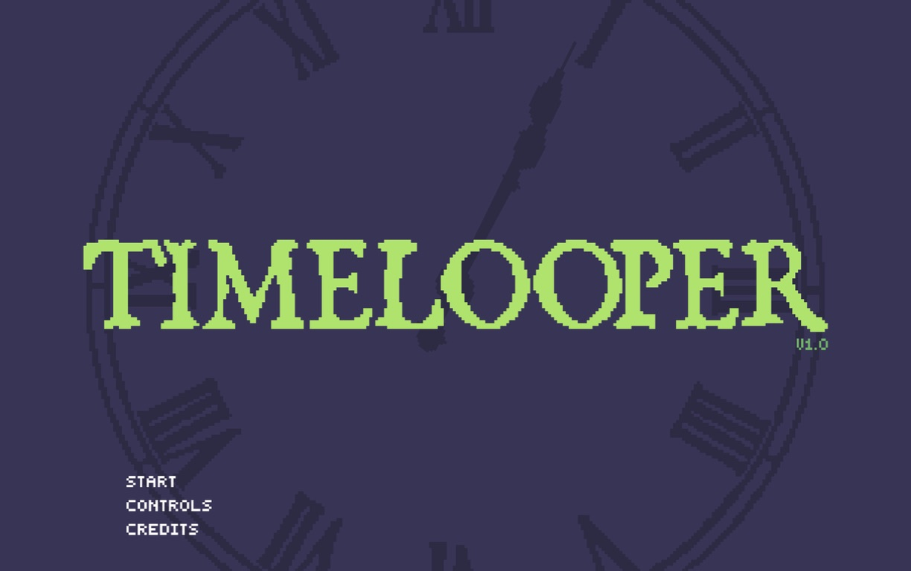
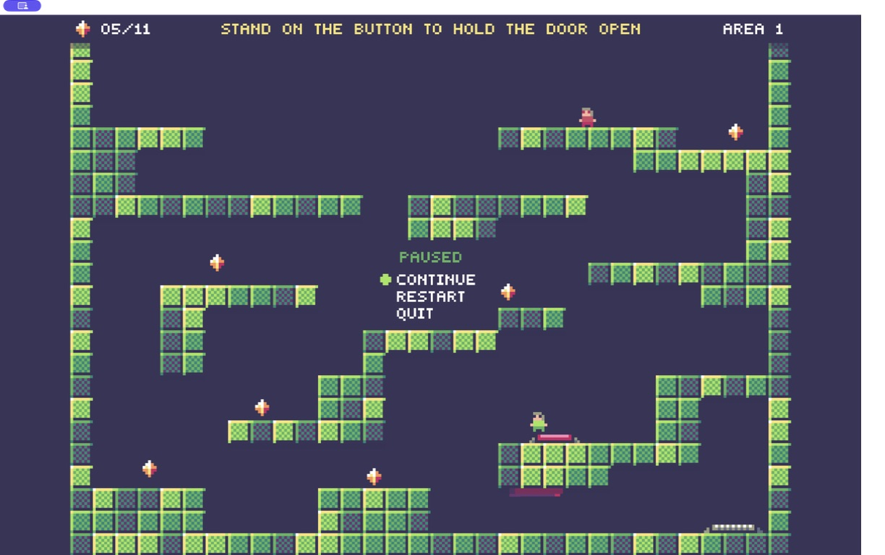

# Time Echo: Gem Exit

Public Input revision: `v2-pilot-20260828`  
GDD revision: `v2-dashboard-migration-20260828`  
Benchmark ID: `defold.timelooper.v2`

> This revision preserves the established gameplay, quantities, timing, visual, and outcome
> requirements. It uses the shared read-only Dashboard contract and defines this game's public
> state mapping in Section 12. Private evaluation journeys and implementation answers are not part
> of this document.

## 1. One-sentence task

Build a side-view time-echo puzzle platformer. The player moves, jumps, and collects gems; uses a
red echo that replays the player's real action history to hold a pressure button and open a door;
avoids echoes and spikes; and finally enters the exit.

## 2. Scope

Build one complete side-view level. Its core loop is moving and jumping, collecting gems, recording
an action history, waiting for an echo to replay it, using that echo to open a door, avoiding
hazards, and reaching the exit.

You do not need to reproduce every level from the original game. Story, saves, leaderboards, level
selection, and a complex ability system are out of scope.

## 3. Starting point

The public Input contains a minimal Defold project that builds and launches, input bindings, and
the required pixel assets. This shared starting point has no menu, character, level, or target
gameplay. Implement all content defined by Section 6 inside `starter_project/`.

## 4. Player goal and complete flow

### 4.1 Player goal

Collect all 5 gems in one complete platforming level, use a real history-replaying echo to hold a
button while the current player passes through the controlled door, avoid echoes and spikes, and
enter the activated exit. See `TL-gems-01～02`, `TL-Echo-01～03`, `TL-Organization-01～02`,
`TL-Danger-01`, and `TL-Exit-01`.

### 4.2 Complete player flow

```text
[TL-Menu-01] Choose Start on the main menu
→ [TL-Move-01, TL-gems-01～02] Move, jump, and collect gems along the route
→ [TL-Echo-01～02] Every 10 seconds, create a red echo that replays this run's history
→ [TL-Echo-03, TL-Danger-01] Avoid contact with echoes and spikes
→ [TL-Organization-01～02] First record an action that walks to the button and waits there
→ The echo repeats that action and holds the button while the current player crosses the open door
→ [TL-Exit-01] Collect all 5 gems and activate the exit
→ The current player enters the exit and wins
→ [TL-Restart-01] After failure or an explicit restart, begin again from a clean level
```

### 4.3 Core loop

```text
[TL-Move-01] Move and jump
→ [TL-gems-01～02] Collect gems and read the level
→ [TL-Echo-01～02] Leave an action history and wait for an echo to replay it
→ [TL-Organization-01～02] Use the echo to change whether the door can be crossed
→ [TL-Echo-03, TL-Danger-01] Avoid contact hazards
→ [TL-Exit-01] Continue exploring or enter the activated exit
```

## 5. Player controls

| Requirement | Player action | Keyboard input | Game response |
|---|---|---|---|
| TL-Move-01 | Move left/right | A/D or Left/Right arrows | Move across platforms |
| TL-Move-01 | Jump | W, Up arrow, Space, or X | Jump over hazards or onto platforms |
| TL-Menu-01 | Confirm menu choice | Enter | Start the game or activate the selected button |
| TL-Restart-01 | Restart | R | Restart from a clean level |
| TL-Pause-01 | Pause/back | Escape | Pause, resume, or go back |

## 6. Numbered requirements: the sole acceptance basis

| Requirement | Formal requirement |
|---|---|
| TL-Menu-01 | Show an operable main menu after launch. The menu must hide the game world or fully isolate it with an opaque background covering the entire client area; level objects, labels, and the HUD must not remain visible behind it. The player can start a new game with the keyboard and can retry or exit after either success or failure. |
| TL-Move-01 | During play, A/D or the Left/Right arrows provide continuous horizontal movement, and W, Up, Space, or X jumps. Holding either horizontal key must keep moving the character until release; a one-second hold must move clearly farther than a tap, and ordinary repeat callbacks while held must not be mistaken for release. The player is affected by gravity, can stand on platforms, and cannot pass through solid platforms or walls. Every listed normal keyboard binding must have consistent press, hold, and release semantics. |
| TL-level-01 | Include one complete side-view level with a start, traversable platforms, 5 gems, at least two separated spike sections, one pressure-button/controlled-door pair, and one exit. The normal route must not require pixel-perfect jumping. |
| TL-level-02 | The level must not be only a screen-wide flat floor plus a few straight floating bars. The playable area has at least three clear low/middle/high height tiers and 8 separated platform sections. A normal successful route requires at least 4 meaningful jumps, lands on at least 3 platforms above the spawn height, and creates route choices between gem collection, the button door, and the exit. The player cannot finish simply by running right along the bottom. |
| TL-gems-01 | When the current player touches an uncollected gem, collect that gem exactly once, remove it from the level, and update the count. The screen continuously shows ` Collected / 5` (collected / 5). Every gem is separated from the player's spawn collider, and a new run that receives no movement remains at `0 / 5`. |
| TL-gems-02 | Until collected, every gem remains visibly rendered at its collision position as a high-contrast, recognizable diamond or gem silhouette at least 20 px in effective diameter. Sparkle, bobbing, or glow may improve recognition. The graphic remains until real contact collects it; invisible gems, transparent textures, or collection colliders that disagree with the visible position are not allowed. |
| TL-Echo-01 | Spawn the first red echo 10 seconds after a new run begins and another echo every 10 seconds thereafter. Each echo starts from this run's player spawn and replays, with the same relative timing, the movement, jumps, and waits that the player actually performed since the start of the run. An echo must not track the current player or use a preset fixed animation. |
| TL-Echo-02 | An echo is clearly visible as a red or translucent-red copy of the player. It can physically hold the pressure button, but it cannot collect gems, activate the exit, or complete the level in place of the current player. |
| TL-Echo-03 | Real contact between the current player and any echo causes immediate failure. Merely spawning an echo without contact must not cause failure. |
| TL-Organization-01 | The controlled door remains open while either the current player or an echo stands on the pressure button and closes after every object leaves. At least once, the required level route must make an echo hold the button while the current player crosses the door; the closed door cannot be bypassed or crossed. |
| TL-Organization-02 | When an echo waits on the button as part of its historical route, the open interval is long enough for the player to pass the door using normal movement and jumping. An open door must actually stop blocking collision and must not depend on collision glitches or frame-perfect timing. |
| TL-Danger-01 | The current player immediately fails on contact with spikes. Before contact, each spike section remains visibly rendered as high-contrast upward teeth or an equivalent hazard silhouette at least 18 px high. Its collision area agrees with the visible hazard; empty ground with no visible spike must not kill the player. Leave enough safe distance before the first spike to observe it and jump. Echo contact with spikes does not fail the current player. |
| TL-Exit-01 | With fewer than 5 gems, the exit remains inactive and touching it cannot win. After all 5 gems are collected, the exit visibly activates. Only the current player entering the activated exit shows clear success feedback and stops ordinary gameplay. |
| TL-Pause-01 | Escape pauses and resumes during play. While paused, the player, echoes, mechanisms, and all timers remain unchanged, and the screen clearly communicates the paused state. |
| TL-Restart-01 | Pressing R or retrying from a result returns the player to spawn, restores every gem and resets the count, clears every echo and all recorded history, and restores the button, door, exit, and outcome state. Closing and reopening the program returns to the main menu with no retained progress. |
| TL-Interface-01 | The player, echoes, platforms, gems, spikes, button, door, and exit are clearly distinguishable in the normal view. At the start of a run, uncollected gems, hazards, and the main mechanism must not disappear because of transparent art, bad cropping, tiny size, or background-matching color. Gem collection, echo spawn, button press, door state, exit activation, pause, failure, and success all have visible feedback synchronized with the real state. Do not rely on many English explanatory labels placed beside scene objects to make them recognizable. |
| TL-Layout-01 | For a 960 × 540 client area with screen coordinates measured from the top-left, the top HUD uses `y=0–60`, the main level uses `y=60–500`, and a short controls hint uses `y=500–540`. Left, center, and right HUD groups respectively show gem, echo, and mechanism/exit information. Keep all text at least 24 px from the left and right window edges, and do not overlap or clip the groups. |
| TL-Layout-02 | The main menu, pause screen, and result screens have clear visual hierarchy. Effective title size is at least 32 px, primary buttons and HUD text at least 18 px, and secondary scene labels at least 14 px. Multiline text must not overlap buttons, doors, gems, characters, other text, or be clipped. Pause and result panels visibly darken the level so background labels do not pass through panel text. |
| TL-Visual-01 | Present a readable pixel-art side-view level, not debug wireframes or a whole sprite sheet stretched onto an object. Platforms create a clear vertical hierarchy; the current player and echoes share a silhouette but have clearly different colors; gems, spikes, the button, door, and exit each use their own correctly cropped sprite or an equivalently clear graphic. |
| TL-Materials-01 | Use the supplied `assets/textures/timelooper_tiles.png` for the main character, platforms, gems, and spikes, and `assets/textures/mechanisms.png` for the button, door, and exit. Crop the sheets into meaningful individual sprites or animation frames; do not display, shrink, or stretch an entire source sheet merely to claim asset usage. Atlases, scaling, tinting, and a red-tinted player image for echoes are allowed. Other supplied assets are optional. |
| TL-Feedback-01 | The desktop build emits sortable, atomic, read-only state snapshots that distinguish separate runs, following `DASHBOARD_SPEC.md`. Snapshots use the consistent world coordinates defined by Section 12 and `naming-tables.json`, fully report the current phase, player motion, platforms, gems, spikes, button, door, exit, and echoes, and keep each object's ID stable within a run. |
| TL-Feedback-02 | Dashboard state remains synchronized with what the player sees, actual collision, and authoritative gameplay state. The next snapshot after gem collection, echo spawn, button press, door change, exit activation, failure, or restart reflects the event that really occurred. Read-only observation must not advance timers, spawn or alter objects, return future state, accept input, or expose a shortcut that changes gameplay. `DASHBOARD_SPEC.md` and Section 12 define the public contract. |

Every task also follows these shared quality requirements:

| Requirement | Formal requirement |
|---|---|
| Quality-01 | The project starts, runs, exits, and starts again through the published normal procedure. |
| Quality-02 | The main flow uses normal player input and does not depend on cheat entries, direct state mutation, or direct outcome triggers. |
| Quality-03 | Critical entries, text, and controls are visible, readable, and operable. |
| Quality-04 | Player actions produce perceivable feedback synchronized with the real game state. |
| Quality-05 | No build error, runtime error, or severe state contradiction blocks the main flow. |
| Quality-06 | From the same initial conditions, repeated runs can reliably complete the normal flow. |

## 7. Original visual references and layout coordinates

The following images come from the MIT-licensed original game used as reference. They constrain
composition hierarchy, object legibility, and pixel-art finish, not a pixel-identical level copy.

### 7.1 Original menu



Reference focus: the menu is an independent full-screen state. Its title, decorative background,
and three menu choices do not overlap, and the level does not show through the menu text.

### 7.2 Original single-screen level and button door



Reference focus: the level fills the main view and creates a route with vertically layered
platforms, gaps, and movement between heights. The top contains only gem progress, a short hint,
and area information. The player, red echo, gems, spikes, platforms, button, and door each have a
distinct high-contrast pixel silhouette, without large explanatory labels beside objects. The
formal coordinate requirements are `TL-Layout-01` and `TL-Layout-02`.

## 8. Difficulty, presentation, and implementation freedom

Difficulty should come from planning action history, using echoes, and avoiding hazards—not from
pixel-perfect jumps, extremely narrow doors, or unpredictable collision. The implementation may
freely choose code structure, physics, scene organization, animation, and ordinary UI layout.

- Section 6 is the sole formal acceptance basis. Other sections provide goals, flow, references,
  and summaries of numbered requirements.
- Implementation freedom does not change Section 6's quantities, timing, inputs, hazard boundaries,
  layout, required asset usage, or read-only state contract.
- Reference images carry only the visual constraints stated in Section 7 and cannot be overlaid as
  a finished game screen.
- Gold implementation details, private journeys, and scoring details are not public requirements or
  implementation shortcuts.

## 9. Pre-submission checklist

- [ ] Section 6 identifiers, values, inputs, state boundaries, layout, asset rules, and state
      contract remain exact.
- [ ] The game starts from its menu; holding A/D or an arrow continuously moves until release; a
      tap and a hold produce clearly different travel distances.
- [ ] Echoes replay real history, can hold the button, and fail the player only on actual contact.
- [ ] An echo has actually held the door open while the current player crossed it.
- [ ] All 5 gems, spike failure, exit success, pause, and restart have been exercised in normal play.
- [ ] A clean-run frame visibly contains 5 gems, two spike sections, the button, door, and exit;
      moving through empty ground cannot trigger an invisible spike or gem.
- [ ] Dashboard snapshots distinguish runs and stable object IDs and fully report the live level.
- [ ] Snapshot state agrees with rendering and collision, and repeated observation changes nothing.
- [ ] A successful route uses low, middle, and high tiers, at least 4 meaningful jumps, and at least
      3 platforms above spawn height.
- [ ] The required supplied assets appear in the actual game view.
- [ ] The menu hides the world, and HUD, scene, and result text is not clipped or overlapping.

## 10. Public v2 submission boundary

Submit the completed `starter_project/`. Normal gameplay uses only the keyboard controls in Section
5. Dashboard is read-only: it cannot accept input, restart, mutate state, or trigger an outcome.
Code organization, internal object names, physics, and an equivalent compliant layout remain free.
The public Input contains no Gold, private checkpoints, scoring rules, or precomputed solution path.

## 11. Shared contracts

This task also follows `COMMON_BASELINE.md` and `DASHBOARD_SPEC.md`. They provide shared playability
and state-format rules without changing Section 6's frozen gameplay quantities, timing, layout,
asset, or outcome semantics.

## 12. Dashboard naming and control mapping

This section matches `naming-tables.json`; the exact machine-readable names in that file are
authoritative.

### 12.1 Coordinates and geometry

- The world uses continuous two-dimensional `world_center_y_up` coordinates. The 960 × 540 game
  view has its origin at the bottom-left, x increases rightward, y upward, and units are view pixels.
- Every entity uses the center of its real collider or object rectangle as `position: [x,y]` and the
  full extent as `size: [width,height]`. Do not mix top-left, bottom-left, or half-size conventions.
- `player`, every `echo`, every `platform`, every `gem`, every `spike`, the button, door, and exit
  have stable IDs within a run. Collection or modal hiding never transfers an ID to another object.
- This task has no mouse gameplay, so `targets` is always empty. If clickable UI is later added, its
  rectangle space remains the 960 × 540 bottom-left-origin game view.

### 12.2 Numeric slots

| Slot | Meaning | Requirements |
|---|---|---|
| `run_serial` | Monotonically increasing run number; 0 before the first run starts | `TL-Restart-01` |
| `elapsed_milliseconds` | Unpaused gameplay time advanced in this run, in milliseconds | `TL-Echo-01`, `TL-Pause-01` |
| `next_echo_milliseconds` | Unpaused milliseconds until the next echo; 0 outside play/pause | `TL-Echo-01` |
| `gems_collected` | Number of collected gems | `TL-gems-01`, `TL-Exit-01` |
| `gem_total` | Total gems in a run; 0 before a level starts, then 5 | `TL-level-01` |
| `echoes_active` | Number of echoes spawned and still present in the current run | `TL-Echo-01` |
| `player_velocity_x`, `player_velocity_y` | Current real world velocity; 0 in the menu | `TL-Move-01` |
| `player_on_ground` | Real grounded state, 0 or 1; 0 in the menu | `TL-Move-01` |
| `button_pressed` | Real pressure-button state, 0 or 1 | `TL-Organization-01` |
| `door_open` | Real controlled-door open state, 0 or 1 | `TL-Organization-01` |
| `exit_active` | Whether all five gems have activated the exit, 0 or 1 | `TL-Exit-01` |
| `loss_reason_code` | 0 when not lost; 1 for spike contact; 2 for echo contact | `TL-Danger-01`, `TL-Echo-03` |

### 12.3 Entities

| Kind | Stable ID | Allowed states | Visibility meaning |
|---|---|---|---|
| `player` | `player` | `grounded`, `airborne` | true while the world is shown |
| `echo` | `echo-1`, `echo-2`, ... | `replaying`, `frozen`, `stopped` | true during normal play; false when hidden by pause/result |
| `platform` | level-defined `p_*` IDs | `solid` | true while the world is shown |
| `gem` | `gem-1` through `gem-5` | `available`, `collected` | true before collection; false afterward |
| `spike` | `spike-1`, `spike-2` | `dangerous` | true while the world is shown |
| `pressure_button` | `button-1` | `released`, `pressed` | true while the world is shown |
| `controlled_door` | `door-1` | `closed`, `open` | true while the world is shown; state matches collision |
| `exit` | `exit-1` | `locked`, `active` | true while the world is shown |

The main menu completely hides the world, so its `entities` is empty. Static world objects that
remain visible beneath pause/result UI are reported truthfully. Echoes hidden by a modal report
`visible:false`. A collected gem keeps its stable ID with `state:"collected"` and `visible:false`.

### 12.4 Phase and normal input

| Game state | Dashboard phase |
|---|---|
| Main menu | `menu` |
| Active level | `playing` |
| Paused | `paused` |
| Success | `won` |
| Spike or echo failure | `lost` |

`controls.movement_template` is `continuous_platformer`. A/D or Left/Right arrows provide continuous
horizontal movement; W, Up, Space, or X jumps; Enter confirms; R restarts; and Escape pauses,
resumes, or returns. Dashboard does not generate any of these inputs.
