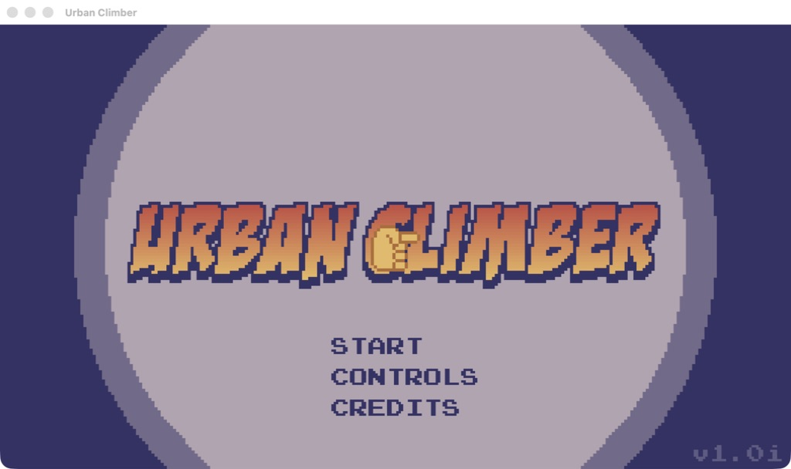
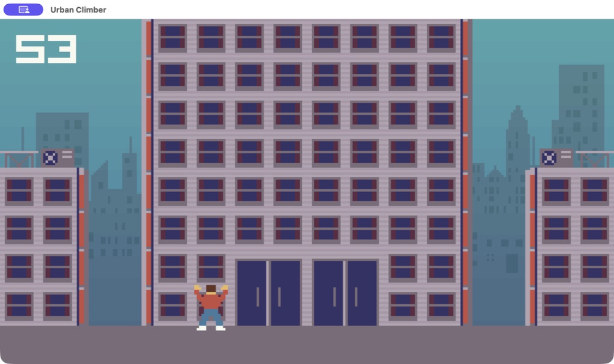
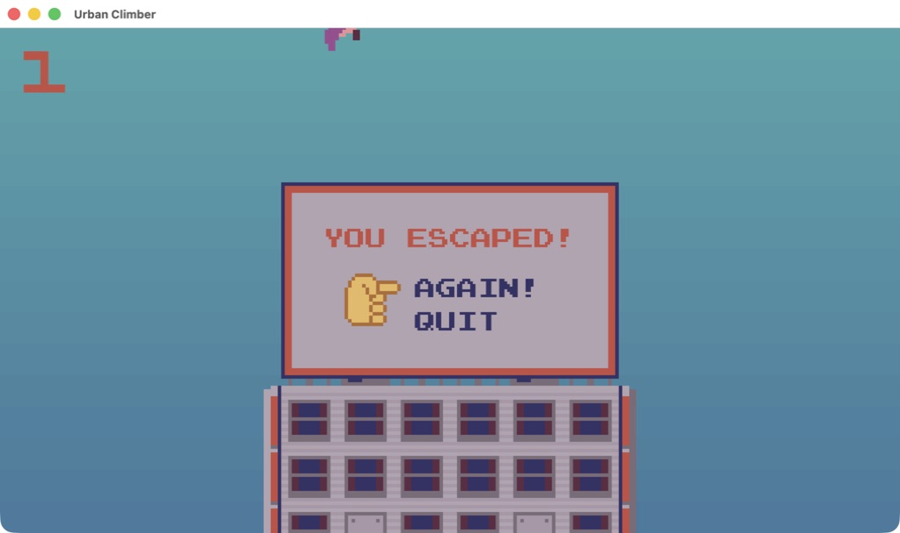

# Urban Climber — Two-Roof Relay

Task ID: `defold_urban_climber_v3`  
Public input: frozen v3 two-building scope

## 1. One-sentence task

Climb two city buildings, avoid warned falling objects, activate a side-route rescue beacon in
the second building, and reach both helicopter pickups before their local timers expire
(`UC-LEVEL-01`, `UC-BEACON-01`, `UC-WIN-01`).

## 2. Scope

Build the climbing and hazard loop (`UC-MOVE-01`, `UC-HAZARD-01`), two fixed buildings
(`UC-LEVEL-01`), one beacon (`UC-BEACON-01`), one temporary closure (`UC-CLOSURE-01`),
and menu/pause/retry/results (`UC-MENU-01`, `UC-PAUSE-01`, `UC-RESET-01`).

Procedural maps, combat, inventory, lives, save systems, wind physics, multiple beacon types,
permanent route changes, and additional campaigns are outside this task.

## 3. Starting state

The supplied project is empty except for normal input bindings and a read-only Dashboard module.
It builds to an empty window with `phase=not_ready`; it contains no target menu or gameplay.
Implement the game within `starter_project/`. Supplied textures and visual references are listed
in the asset manifest. The completed game's initial state is defined by `UC-MENU-01`.

## 4. Player goal and flow

```text
menu → Building 1 climb → roof arrival and helicopter extraction
     → checkpoint → Building 2 climb, beacon and temporary closure
     → roof arrival and helicopter extraction → campaign success
     ↘ local timer expires → failure → retry current building or menu
```

The flow follows `UC-WIN-01`, `UC-WIN-02`, `UC-LOSE-01`, and `UC-RESET-01`.
The repeated decision is to climb, transfer, or wait after reading a visible hazard warning
(`UC-MOVE-01`, `UC-HAZARD-02`).

## 5. Player controls

| Input | Context and response | Requirement |
|---|---|---|
| Arrows or WASD | Move to an adjacent connected climbing point | `UC-MOVE-01` |
| Enter or Space | Confirm UI; interact with the beacon during climbing | `UC-MENU-01`, `UC-BEACON-01` |
| Up/Down or W/S | Select a visible menu/overlay choice | `UC-MENU-01` |
| Escape | Pause/resume active climbing | `UC-PAUSE-01` |
| R | Retry current building from pause or a result | `UC-RESET-01` |
| Q | Return to menu from pause/results; quit from main menu | `UC-MENU-01`, `UC-RESET-02` |

## 6. Numbered requirements — authoritative gameplay source

### 6.1 Authority

Section 6.2 defines the game-specific requirements. Other sections summarize them; Section 12
defines their public observation names, not additional gameplay. The shared
`COMMON_BASELINE.md` applies alongside these requirements.

### 6.2 Requirements

| Requirement | Formal requirement |
|---|---|
| `UC-MENU-01` | Launch into a separate main menu with a readable title, Start and Quit, and a short control explanation. The building and HUD do not show through the menu. Up/Down or W/S selects a clearly highlighted choice; Enter or Space confirms. Start begins Building 1. Pause/results offer the choices specified below with the same keyboard operation. Q quits only from the main menu. |
| `UC-LEVEL-01` | Provide exactly two deterministic buildings, each with three columns of climbing routes and eighteen rows, indexed from street row 0 to roof row 17. Their connection layouts differ. Each has a viable street-to-roof path requiring at least two horizontal transfers; repeatedly pressing only Up from spawn cannot reach the roof. Connections and gaps are readable, and no required route becomes permanently blocked. |
| `UC-LEVEL-02` | Each facade is a continuous world at least twice as tall as the main play viewport. At a fresh start only street and lower floors are visible, not the roof or helicopter. Climbing requires sustained vertical scrolling, with at least three visibly different vertical views before reaching the roof. |
| `UC-MOVE-01` | Arrows and WASD move one adjacent connected point per press, without crossing gaps or skipping points. A legal press responds visibly within 0.10 seconds and finishes within 0.45 seconds; there is no fixed post-move lock longer than 0.15 seconds. Three legal presses about 0.20 seconds apart execute in order, without silently dropping one. Invalid movement leaves the current point unchanged and gives brief visible rejection feedback. |
| `UC-TIMER-01` | Each fresh building starts with 45 seconds. Time decreases only during active climbing, including hit recovery. It freezes during pause, extraction, checkpoint, and results. The remaining time is always readable during the level and never becomes negative. Starting Building 2 gives a new 45 seconds, not Building 1's remaining time. |
| `UC-HAZARD-01` | Both buildings contain visually distinct falling flowerpots and bird eggs. They can be avoided by changing route or waiting; unavoidable damage and frame-perfect dodges are not required. Their schedules repeat deterministically when that building is retried. |
| `UC-HAZARD-02` | Every falling object comes from an identifiable facade window that visibly warns for at least 0.50 seconds before the object appears at its opening. Warnings and objects scroll with the building. Objects never originate in the HUD, above the roof, or on an empty route without a source window. A clean viable climb encounters at least three visible source-window warnings in each building. |
| `UC-HIT-01` | Only real collision with a falling object makes the player drop approximately four rows, clipped at street level, with clear hit/recovery feedback. The same object does not repeatedly apply that drop. A miss causes no hit. Climbing resumes after recovery; there are no health, lives, or hit-count loss rules. |
| `UC-PACING-01` | Design for a clean fastest viable climb of 7–22 seconds in Building 1, and a clean beacon-and-roof route of 10–30 seconds in Building 2, measured in unpaused climbing time and excluding extraction/checkpoint screens. These are pacing targets, not frame-exact limits. The route and warned obstacles should require observation; do not manufacture duration through unresponsive controls, an invisible timer lock at the roof, or a post-move lock. Both buildings must be comfortably finishable within their local timers without taking hits. |
| `UC-BEACON-01` | Building 2 has exactly one visible rescue beacon on a side route, initially inactive. Enter or Space activates it only while the player occupies an orthogonally adjacent climbing point, with a traversable connection to the beacon point. One valid interaction visibly changes it to active. Activation is idempotent. Pressing the key away from an inactive beacon shows a brief MOVE CLOSER message or equivalent without changing it. Building 1 has no beacon. |
| `UC-BEACON-02` | Building 2's roof is visibly locked until the beacon is active. Trying to reach a locked roof does not begin extraction or complete the building and gives a clear beacon-required message. Activating the beacon visibly opens the roof goal, but does not teleport the player or start extraction remotely. Building 1's roof is open from the start. |
| `UC-CLOSURE-01` | In Building 2, exactly one upward route passage undergoes one deterministic temporary closure per attempt. It warns visibly for at least 0.75 seconds while still traversable, then closes for 1.5–2.5 seconds, then visibly reopens for the remainder of that attempt. This is not a damaging hazard. While closed, upward movement through that passage is rejected; descent is unaffected. Waiting for reopening or taking another visible connection always remains possible. The event is placed/timed so a normal clean climb can encounter its warning; no future schedule is disclosed. Building 1 has no such closure. |
| `UC-WIN-01` | Arriving at an open roof while time remains stops ordinary movement, interaction, damage, and timer progression. Visibly show roof arrival followed by continuous helicopter arrival and pickup/departure, not an immediate static result page. Building 1 extraction leads to a distinct checkpoint identifying Building 1 as complete and Building 2 as next. Enter or Space at that checkpoint starts Building 2; it is not final success. |
| `UC-WIN-02` | Only completion of Building 2's extraction enters final success. Show YOU ESCAPED! or equivalent campaign-complete feedback, and visible Retry Building 2 and Menu choices. Success remains until a choice. Movement and interaction do not alter the completed level. |
| `UC-LOSE-01` | Time reaching zero before valid roof arrival causes a visible OUT OF TIME! or equivalent failure for the current building. If time is already zero, roof arrival cannot rescue the attempt. Failure stops gameplay and offers Retry Current Building and Menu. Hits alone never trigger failure. |
| `UC-PAUSE-01` | Escape during active climbing opens one visible pause overlay with Resume, Retry Current Building, and Menu; Escape or Resume returns to climbing. Player movement/recovery, hazards/warnings, timer, beacon interactions, and closure timing freeze. Repeated Escape presses do not stack overlays. Escape and ordinary climbing input do not skip extraction, checkpoint, or results. |
| `UC-RESET-01` | Retry from pause, failure, or final success, including R, resets only the current building to its deterministic clean start: street spawn, 45 seconds, hazards, warning/closure schedule, beacon, roof, camera, pending moves, and overlays. Building 2 retries keep Building 1 completed but reset its own beacon and locked roof. Retry after success replays Building 2. Repeated retries do not stack objects or retain prior transient state. |
| `UC-RESET-02` | Menu from pause/results, or Q there, discards the campaign. Closing and relaunching also returns to the main menu without progress. The next Start always begins Building 1. There is no persistent save. |
| `UC-UI-01` | At a 960 × 540 game view, provide a readable top HUD, a separate main world viewport, and a short bottom control hint. HUD shows current building out of two, remaining time, route/height, and current status; Building 2 also shows beacon status. Player, available connections, warnings, temporary closure, beacon, roof, hit, pause, checkpoint, and results are distinguishable. Text and choices do not overlap or clip and do not obscure important play objects. |
| `UC-CAMERA-01` | HUD and control hints stay in screen space. The camera follows climbing smoothly while preserving useful view ahead; facade windows, routes, beacon, closure, and hazards move with the world. The viewport's visible row range agrees with what is rendered. |
| `UC-VISUAL-01` | The facade reads as a city building with walls, windows, and a roof, not a node-graph/debug display. The human climber, flowerpot, egg, and helicopter are recognizable, with independent silhouettes. Use cropped semantic sprites rather than a whole sprite sheet or plain diagnostic rectangles. Menus, pause, checkpoint, and results have clear visual hierarchy. |
| `UC-ASSET-01` | Use the supplied principal urban tile sheet for the player, building/climbing elements, and falling hazards, and the supplied helicopter image for extraction. Cropping, atlas creation, scaling, tinting, and composition are allowed; whole-sheet display does not count. Other supplied assets are optional. Beacon and closure may use simple original, recognizable artwork. No particular audio or font is required. |
| `UC-DASHBOARD-01` | Implement the shared read-only Dashboard with the exact vocabulary in Section 12 and naming-tables.json. Report the current level, progress, timer, player, active anchors, current connections, building height, visible row range, beacon, closure, roof, and extraction stage from the same state used by gameplay and rendering. Observing it never changes gameplay or accepts actions. |
| `UC-DASHBOARD-02` | Report source windows, warnings only after they begin, and falling objects only after spawn. Never publish future hazard/closure schedules or answer routes. Stable IDs, current cells, and truthful visibility agree with collision and scrolling. Off-screen current objects are not claimed visible. |

## 7. Success, failure, and stages

`UC-WIN-01` separates roof arrival, extraction, and the first-building checkpoint.
`UC-WIN-02` reserves final success for the second pickup. `UC-LOSE-01` defines local timeout.
These outcomes cannot be replaced by a hit-count rule or by completing only the first building.

## 8. Interface and feedback

The player reads the facade and HUD (`UC-UI-01`, `UC-CAMERA-01`), window and closure warnings
(`UC-HAZARD-02`, `UC-CLOSURE-01`), and beacon/roof readiness (`UC-BEACON-01`, `UC-BEACON-02`).
Reference images illustrate the intended hierarchy and object readability, not the new level
layout or a pixel-identical target (`UC-VISUAL-01`).







## 9. Restart and persistence

Local retry retains only the completed-building checkpoint (`UC-RESET-01`). Menu and full
relaunch discard it (`UC-RESET-02`). The blank starter has no campaign or saved state.

## 10. Existing-feature preservation

This is a standalone rebuild from an empty project, not a patch to an existing playable game.

## 11. Assets and content

The principal sprites and helicopter are required by `UC-ASSET-01`. Paths, dimensions, slicing
facts, usage rights, and optional textures are in [assets/ASSET_MANIFEST.md](assets/ASSET_MANIFEST.md).
The visual references do not override the numbered rules or require their original UI wording.

## 12. Dashboard naming and normal controls

This is the observation vocabulary for `UC-DASHBOARD-01` and `UC-DASHBOARD-02`, using
`DASHBOARD_SPEC.md` and `naming-tables.json`. The task is deterministic with no seed entry.

### 12.1 Numeric slots

| Slot | Meaning | Requirements |
|---|---|---|
| `time_remaining` | Current building seconds remaining; 45 at its fresh start | `UC-TIMER-01` |
| `height_row` | Player's current logical climbing row, 0–17 | `UC-MOVE-01` |
| `total_rows` | 18 while a building is loaded | `UC-LEVEL-01` |
| `visible_row_min`, `visible_row_max` | Lowest/highest climbing rows intersecting the current world viewport, inclusive and clipped to 0–17 | `UC-CAMERA-01` |
| `level_index` | 1 or 2 while a building is loaded; 0 in menu/loading | `UC-LEVEL-01`, `UC-RESET-02` |
| `beacon_activated` | 0 inactive or absent; 1 active; always 0 in Building 1 | `UC-BEACON-01` |
| `campaign_checkpoint` | 0 before Building 1 extraction finishes; 1 afterward, including Building 2 retry and final success | `UC-WIN-01`, `UC-RESET-01` |
| `stage_code` | 0 no level; 1 climbing (also paused or timed out); 2 extraction; 3 first-building checkpoint; 4 final success | `UC-WIN-01`, `UC-WIN-02`, `UC-LOSE-01` |

Menu/loading reports all slots as zero, with no gameplay entities. During the checkpoint,
Building 1's terminal state remains reported until Building 2 starts. Paused and result snapshots
retain the corresponding frozen level state rather than inventing a fresh initial state.

### 12.2 Entities and geometry

Every entity uses a stable logical-object ID and `cell: [column,row]` on the current building's
3 × 18 grid. `(0,0)` is left/street and `(2,17)` is right/roof. IDs distinguish new objects in
different buildings or attempts. Animated objects report their current logical cell, not a planned
destination. Off-screen current objects report `visible:false`; objects outside the grid, including
a helicopter before it enters the roof area, are omitted until inside the observation space.

| Kind | Meaning and allowed state | Requirements |
|---|---|---|
| `player` | Current climber: `normal`, `moving`, `hit` | `UC-MOVE-01`, `UC-HIT-01` |
| `climb_anchor` | Current climbing point: `active` | `UC-LEVEL-01` |
| `movement_edge` | Direction from its source cell: `up_open`, `up_blocked`, `down_open`, `left_open`, `right_open` | `UC-MOVE-01`, `UC-CLOSURE-01` |
| `source_window` | Actual source window: `idle`, `warning` | `UC-HAZARD-02` |
| `flowerpot`, `bird_egg` | A spawned hazard: `falling` | `UC-HAZARD-01` |
| `roof_goal` | Goal: `locked` before beacon, `open` when reachable, `reached` after valid arrival | `UC-BEACON-02`, `UC-WIN-01` |
| `helicopter` | Extraction craft: `inbound`, `departing`; absent before extraction | `UC-WIN-01` |
| `rescue_beacon` | Building 2 beacon: `inactive`, `active` | `UC-BEACON-01` |
| `route_closure` | Building 2 upward passage at its source cell: `warning`, `closed`, `open` | `UC-CLOSURE-01` |

A movement edge goes exactly one cell in its named direction to an existing anchor. Current open
edges are the actual legal transitions. A closed upward passage reports `up_blocked`, not
`up_open`. Unavailable directions other than an upward blocked passage are omitted. These facts
describe the current map, not a suggested route. A closure entity appears only once its visible
warning starts, then remains through closed/open states; it does not advertise the future event.
There are no clickable targets in this keyboard-operated task (`targets: []`).

### 12.3 Phase mapping

| Situation | `phase` | `stage_code` |
|---|---|---:|
| Empty starter/loading | `not_ready` | 0 |
| Main menu | `menu` | 0 |
| Active climb | `playing` | 1 |
| Paused climb | `paused` | 1 |
| Extraction in either building | `playing` | 2 |
| Building 1 checkpoint awaiting confirmation | `playing` | 3 |
| Final extraction complete | `won` | 4 |
| Local timeout | `lost` | 1 |

Normal input uses `discrete_keys`, as in Section 5. In-game action IDs and physical key aliases
are listed in `TOOLCHAIN.md`; no observation channel can start, move, reset, or win the game.

## 13. Implementation boundary

Submit the completed `starter_project/` with normal keyboard gameplay and a truthful Dashboard.
Internal scene structure, data structures, and algorithms are implementation choices. The public
package supplies no solution route or alternate state-changing debug interface.

## 14. Requirement index

Menu: `UC-MENU-01`. Buildings/camera: `UC-LEVEL-01/02`, `UC-CAMERA-01`.
Movement/time/hazards: `UC-MOVE-01`, `UC-TIMER-01`, `UC-HAZARD-01/02`, `UC-HIT-01`, `UC-PACING-01`.
Second-building additions: `UC-BEACON-01/02`, `UC-CLOSURE-01`.
Lifecycle: `UC-WIN-01/02`, `UC-LOSE-01`, `UC-PAUSE-01`, `UC-RESET-01/02`.
Presentation/observation: `UC-UI-01`, `UC-VISUAL-01`, `UC-ASSET-01`, `UC-DASHBOARD-01/02`.
